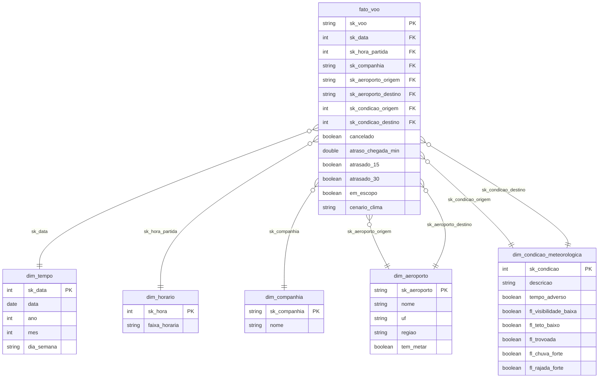

# Modelo de dados: esquema estrela

O fato é a **etapa de voo**. A dimensão de condição meteorológica é usada em dois papéis (*role-playing*): na origem, no horário previsto de partida, e no destino, no horário previsto de chegada. O mesmo acontece com a dimensão de aeroporto.

O diagrama mostra os atributos principais; a lista completa está em [`catalogo_dados.md`](catalogo_dados.md).

## Por que estrela, e não *flat*
As perguntas P1–P5 cortam a mesma medida (atraso) por aeroporto, horário, mês, companhia e condição meteorológica. Com dimensões separadas, cada corte é uma junção simples, e a condição meteorológica é descrita uma única vez (33 linhas) em vez de repetida em ~2 milhões de etapas.

## Código da condição meteorológica
`sk_condicao` é a soma dos pesos dos fatores presentes na observação METAR aplicável:

| Fator | Peso |
|---|---|
| Visibilidade < 5 km | 1 |
| Teto < 1.500 ft | 2 |
| Trovoada (TS, VCTS) | 4 |
| Chuva forte (+RA, +SHRA, +TSRA) | 8 |
| Rajada ≥ 25 kt | 16 |

Exemplo: `5` = visibilidade baixa + trovoada. `0` = tempo bom. `-1` = sem observação válida nos 90 min anteriores.
